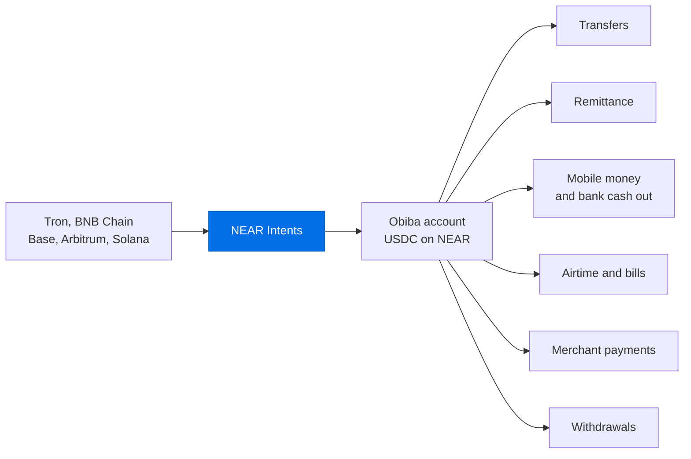
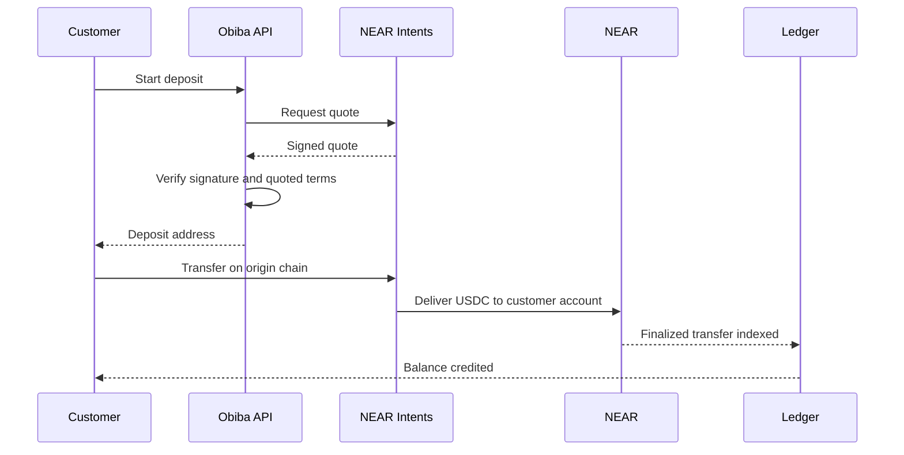
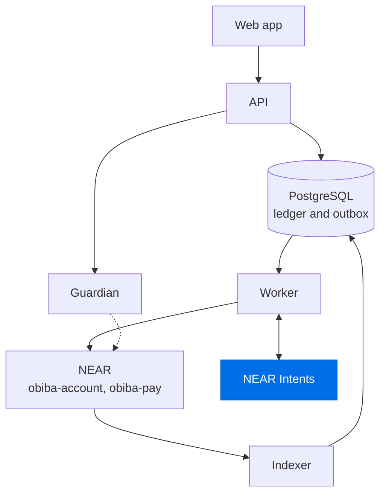

<picture>
  <source media="(prefers-color-scheme: dark)" srcset="https://app.obibajk.com/brand/obiba-logo-light.png">
  
</picture>

Obiba is a USDC account for Africa, built on NEAR and focused first on Ghana. Customers hold digital dollars in an account they control, fund it from other networks through NEAR Intents, and use it for transfers, remittance, mobile money, airtime and bills.

This repository contains the Obiba backend. The web app is at [app.obibajk.com](https://app.obibajk.com).



## Capabilities

| Capability | Description |
| --- | --- |
| Deposits | USDC directly on NEAR, or USDT, USDC and SOL from Tron, BNB Chain, Base, Arbitrum and Solana through NEAR Intents |
| Transfers | To any Obiba customer by name or phone number, or to any NEAR account, with network fees sponsored |
| Remittance | To mobile money and bank accounts in Ghana, Kenya and Nigeria, and to bank accounts in South Africa |
| Mobile money | Cash out to MTN, Telecel and AT |
| Bank payouts | Cash out to GCB, Ecobank, Stanbic, Absa and Fidelity |
| Airtime and data | MTN, Telecel and AT |
| Bills | ECG prepaid electricity, Ghana Water, DStv and GOtv |
| Merchant payments | QR codes and payment links backed by signed invoices |
| Withdrawals | To NEAR accounts, or to USDC on Base and Arbitrum through NEAR Intents |

Mobile money, bank, remittance and bill payments currently run on a pilot rail pending provider integrations.

## NEAR Intents

Cross-chain deposits and withdrawals use NEAR Intents through the 1Click API. Obiba verifies each step independently, and a customer's balance changes only when the transfer is confirmed on NEAR. 1Click operates on NEAR mainnet; the hosted app currently runs on NEAR testnet.



| Stage | Verification |
| --- | --- |
| Quote | The quote signature is checked, and every signed field must match the request |
| Deposit | Credited only when the indexer reads a matching transfer on NEAR |
| Withdrawal | Completed only after the transfer is verified on the destination chain, with 10 confirmations |
| Exceptions | Short deliveries and unmatched transfers are held for review |

## Architecture



| Service | Responsibility |
| --- | --- |
| `api` | GraphQL API, restricted to allow-listed operations. Prepares payments for signing on the customer's device |
| `worker` | Relays signed transactions, provisions accounts, tracks deposits and withdrawals, sends customer email |
| `indexer` | Streams finalized NEAR blocks into the double-entry ledger |
| `guardian` | Independent service that co-signs payments above the account limit |
| `admin`, `ops` | Staff API and operations console |

## NEAR integration

| Feature | Use in Obiba |
| --- | --- |
| NEAR Intents | Cross-chain deposits and withdrawals |
| Global contracts | One `obiba-account` deployment shared by every customer, at about 0.009 NEAR per new account |
| Delegate actions | Customers sign payments, and Obiba pays the network fees |
| Function-call keys | Device keys can only call the customer's own account |
| Named accounts | Readable account names under the Obiba namespace |

## Security model

- Customers authorize payments with a non-extractable key held on their device.
- Spending limits are enforced by the account contract. Payments above the limit require a guardian co-signature, and the guardian cannot move funds alone.
- Account recovery uses SMS and email verification, followed by a 48-hour on-chain delay that an existing device can cancel.
- A reconciler compares the ledger with NEAR and pauses outgoing payments on any account that does not match.
- Business events and their follow-up jobs commit in a single database transaction.
- Each service uses its own database role, with row-level security on customer data.
- Sensitive staff actions require approval from a second person.

<details>
<summary>Repository structure</summary>

| Path | Contents |
| --- | --- |
| `apps/api` | NestJS and GraphQL API |
| `apps/worker` | Background jobs, relayer and email |
| `apps/indexer` | Block stream and ledger settlement |
| `apps/guardian` | Co-signing service |
| `apps/admin`, `apps/ops` | Staff API and console |
| `packages/domain` | Encodings, state machines and shared types |
| `packages/db` | Migrations and ledger |
| `packages/near` | RPC, signing and event extraction |
| `packages/intents` | 1Click client and quote verification |

</details>

<details>
<summary>Build</summary>

Requires Node 22 and pnpm 10.

```bash
pnpm install
pnpm build
```

</details>
